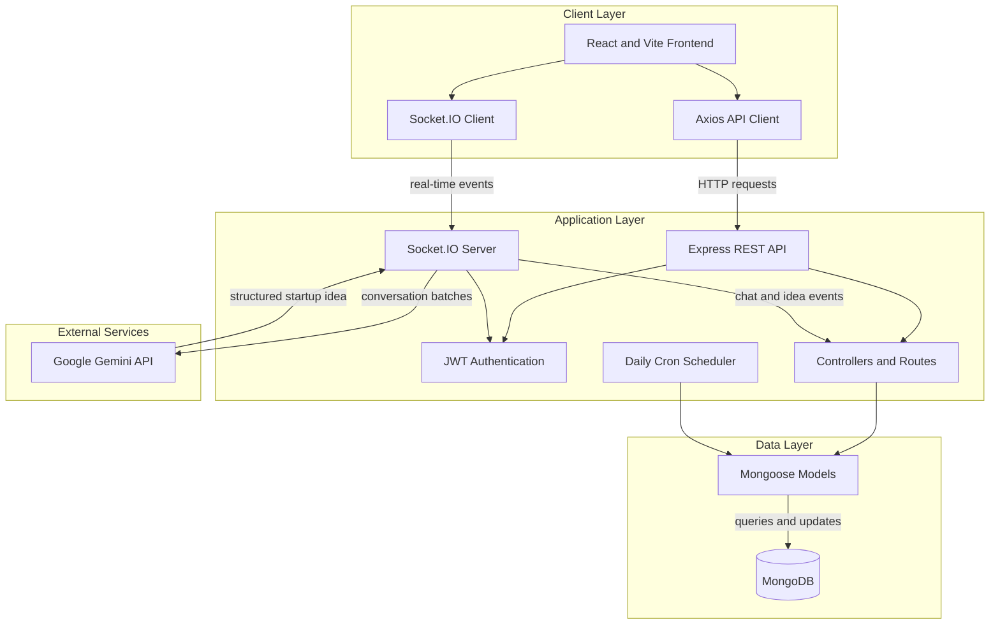
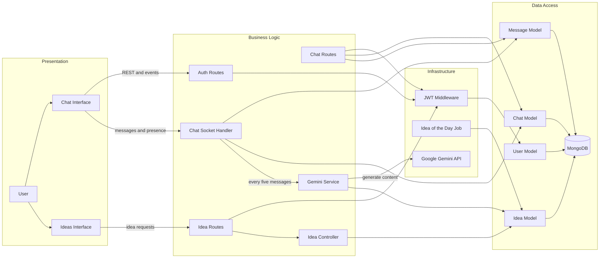

<div align="center">

# IdeaMining Machine

### Real-Time Conversations, AI-Powered Startup Discovery

**An intelligent chat platform that transforms everyday conversations into actionable startup ideas using Google Gemini.**

<p>
  
  
  
  
  
  
  
</p>

<p>
  <a href="#features">Features</a> •
  <a href="#technology">Tech Stack</a> •
  <a href="#getting-started">Quick Start</a> •
  <a href="#api-reference">API Reference</a>
</p>

</div>

---

IdeaMining Machine combines real-time collaboration with generative AI to identify startup opportunities, user problems, and market gaps from conversations.

## Features

- Real-time one-to-one chat with typing and online-status indicators
- AI-assisted startup idea extraction from chat conversations
- Normal-user and innovator accounts
- Free innovator access to one idea per day
- Premium innovator access to up to three ideas per day and full idea details
- Daily idea rotation
- Responsive interface built with Tailwind CSS

## Technology

### Frontend

- React 19
- Vite
- Tailwind CSS
- React Router
- Axios
- Socket.IO Client
- Lucide React

### Backend

- Node.js
- Express
- MongoDB and Mongoose
- Socket.IO
- JWT
- bcryptjs
- Google Generative AI SDK
- node-cron

## System Architecture

The application uses a split frontend and backend architecture. The React client uses REST for authentication and data retrieval, and Socket.IO for live chat, presence, typing indicators, and newly detected ideas.

<!-- mermaid-checked: no \n, no em-dash/en-dash, no {} in labels, subgraphs are id["label"], arrows are -->|"label"|, all subgraphs closed by end, ids unique -->


### Architecture Layers

| Layer | Technology | Responsibility |
| --- | --- | --- |
| Client | React, Vite, Tailwind CSS | Pages, components, authentication state, REST and Socket.IO clients |
| API | Express, JWT | Authentication, authorization, chat, user, and idea endpoints |
| Real-time | Socket.IO | Messages, typing indicators, online status, and idea notifications |
| Data | MongoDB, Mongoose | Users, chats, messages, and generated ideas |
| AI | Google Gemini | Detects startup opportunities from conversation batches |
| Scheduling | node-cron | Updates the daily idea-of-the-day record |

## System Block Diagram

The message-to-idea flow is triggered after five unanalyzed messages in a chat. Generated ideas are stored in MongoDB and announced to connected clients.

<!-- mermaid-checked: no \n, no em-dash/en-dash, no {} in labels, subgraphs are id["label"], arrows are -->|"label"|, all subgraphs closed by end, ids unique -->


### Main Data Flow

1. A user signs in and receives a JWT token.
2. The frontend uses the token for protected REST requests and Socket.IO authentication.
3. Chat messages are saved to MongoDB and broadcast to the active chat room.
4. After five unanalyzed messages, the backend sends the conversation batch to Gemini.
5. A detected idea is saved, and connected clients receive a `new_idea_detected` event.

## Project Structure

```text
BuildX/
├── backend/
│   ├── controllers/     # Request handlers
│   ├── cron/            # Scheduled jobs
│   ├── middleware/      # Authentication and authorization
│   ├── models/          # Mongoose models
│   ├── routes/          # API routes
│   ├── services/        # Gemini integration
│   ├── socket/          # Socket.IO event handlers
│   ├── .env.example
│   ├── package.json
│   └── server.js
├── frontend/
│   ├── public/
│   ├── src/
│   │   ├── components/
│   │   ├── context/
│   │   ├── pages/
│   │   └── services/
│   ├── .env.example
│   └── package.json
└── README.md
```

## Prerequisites

- Node.js 16 or newer
- npm
- MongoDB running locally or a MongoDB connection string
- A Google Gemini API key

## Getting Started

### 1. Clone the repository

```bash
git clone https://github.com/Rahul-sg123/Build-X.git
cd Build-X
```

### 2. Configure the backend

```bash
cd backend
npm install
```

Copy `backend/.env.example` to `backend/.env` and update the values:

```env
PORT=5000
MONGODB_URI=mongodb://localhost:27017/ideamining
JWT_SECRET=replace_with_a_long_random_secret
GEMINI_API_KEY=your_gemini_api_key
NODE_ENV=development
```

On Windows PowerShell:

```powershell
Copy-Item .env.example .env
```

On macOS/Linux:

```bash
cp .env.example .env
```

### 3. Configure the frontend

Open a second terminal:

```bash
cd frontend
npm install
```

Copy `frontend/.env.example` to `frontend/.env`:

```env
VITE_API_URL=http://localhost:5000/api
VITE_SOCKET_URL=http://localhost:5000
```

### 4. Run the application

Start the backend from `backend/`:

```bash
npm run dev
```

Start the frontend from `frontend/`:

```bash
npm run dev
```

The frontend is typically available at `http://localhost:5173`. The backend exposes its health check at `http://localhost:5000/api/health`.

For a production-style backend start:

```bash
npm start
```

For a frontend production build and local preview:

```bash
npm run build
npm run preview
```

## User Roles

| Role | Access |
| --- | --- |
| Normal user | Registration, login, and chat |
| Free innovator | Normal user access plus one idea per day |
| Premium innovator | Up to three ideas per day, full idea details, and premium features |

Users select the innovator role during registration. An innovator can use the premium upgrade endpoint to enable premium access.

## API Reference

All protected endpoints require:

```http
Authorization: Bearer <jwt-token>
```

### Authentication

| Method | Endpoint | Description |
| --- | --- | --- |
| `POST` | `/api/auth/register` | Register a user |
| `POST` | `/api/auth/login` | Log in and receive a JWT |
| `GET` | `/api/auth/profile` | Get the authenticated user profile |
| `POST` | `/api/auth/upgrade-premium` | Upgrade an innovator account |

### Chat

| Method | Endpoint | Description |
| --- | --- | --- |
| `GET` | `/api/users` | List users available for chat |
| `GET` | `/api/chats` | List the authenticated user’s chats |
| `POST` | `/api/chats` | Create or open a chat |
| `GET` | `/api/chats/:chatId/messages` | Retrieve chat messages |

### Ideas

| Method | Endpoint | Description |
| --- | --- | --- |
| `GET` | `/api/ideas` | Get ideas within the user’s daily limit |
| `GET` | `/api/ideas/today` | Get the current idea of the day |
| `GET` | `/api/ideas/:ideaId` | Get full idea details; premium access required |

### Health

```http
GET /api/health
```

Returns the current API status.

## Socket.IO Events

### Client to server

- `join_chat` - Join a chat room
- `send_message` - Send a chat message
- `typing` - Notify participants that a user is typing
- `stop_typing` - Clear the typing indicator

### Server to client

- `new_message` - A new message was received
- `user_typing` - A participant is typing
- `user_stop_typing` - A participant stopped typing
- `user_status` - A participant's online/offline status changed
- `new_idea_detected` - A new startup idea was detected

Socket connections are authenticated with the JWT issued during login.

## AI Idea Mining

The backend sends eligible conversation content to Gemini to identify:

- Startup opportunities
- User problems and complaints
- Potential market opportunities
- Innovation gaps

Generated ideas include a title, detected problem, proposed solution, market context, and future scope. The scheduled job runs daily at midnight to update the idea-of-the-day flag.

## Development Commands

### Backend

```bash
npm run dev    # Start with Nodemon
npm start      # Start with Node
```

### Frontend

```bash
npm run dev     # Start the Vite development server
npm run build   # Create a production build
npm run preview # Preview the production build
npm run lint    # Run ESLint
```

## Security Notes

- Never commit `.env` files or API keys.
- Use a long, unique `JWT_SECRET` outside local development.
- Restrict MongoDB network access in deployed environments.
- Configure the backend CORS origin for the deployed frontend.

## License

This project is released under the MIT License.
